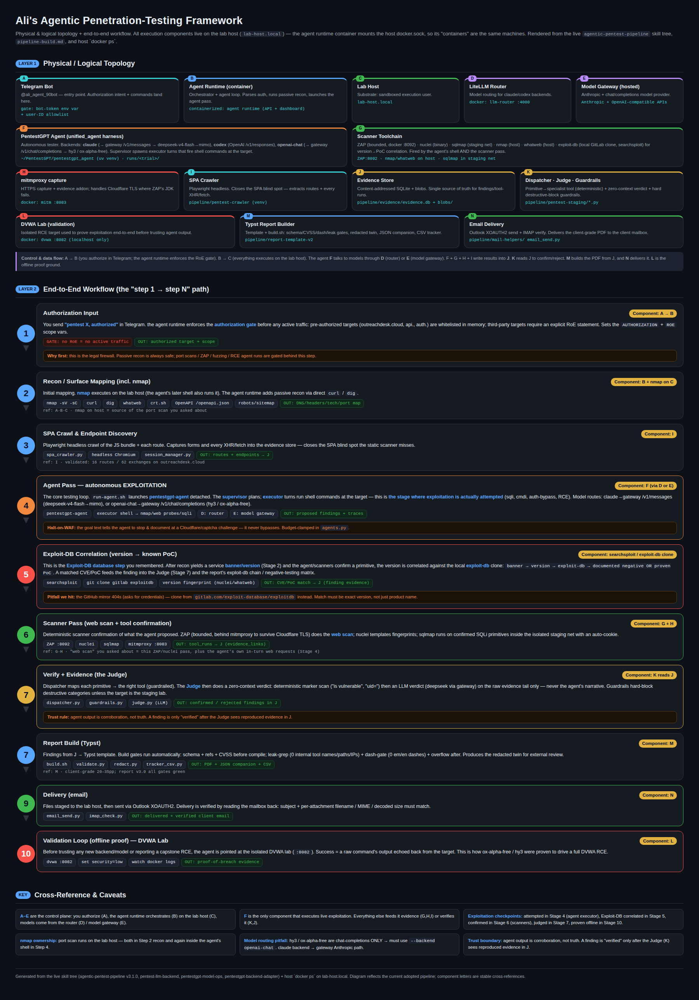

# Ali Arsalan — Security & Engineering Portfolio

**CISSP · OSCP · CCIE-Security · AWS Solutions Architect Professional / Security Specialty**
Cybersecurity engineer (15+ years: enterprise security architecture, cloud security, offensive testing). Current focus: **AI security — securing LLM-integrated applications and agentic systems**.

This repository hosts selected, **redacted** sample work: an agentic security pipeline, and the production SaaS I built and then tested with it. Full versions and additional case material available on request: **a.aly@live.com**

---

## Agentic Penetration Testing Platform

An end-to-end automated penetration-testing pipeline that combines traditional offensive-security tooling with LLM-driven analysis and multi-stage quality gates.

**Pipeline stages:**

1. **Recon & crawling** — target mapping, SPA-aware crawling, technology fingerprinting
2. **Vulnerability scanning** — Nmap, Metasploit, web-application scanners
3. **LLM analysis agent** — an AI agent reasons over scan output and raw traffic, plans exploitation steps, and drives interactive testing (SQLi, auth bypass, business-logic abuse)
4. **Automated QA gate** — a zero-context LLM judge re-verifies every claimed finding against the raw evidence; unsupported claims are rejected before they reach the report
5. **Report generation** — templated, commercial-grade reports (executive summary, technical findings with CVSS, remediation tracker) with automated **redaction and data-leak checks** before release

**Design principles:**

- Human-in-the-loop rules-of-engagement gating — no test runs without explicit authorization
- Evidence-first findings — every claim must trace to captured evidence (requests, responses, screenshots)
- Negative results recorded with equal structure to positives (tested-and-clean vs. not-tested vs. vulnerable)
- Two-person discipline built in: generator and judge are separate, independent passes

## Sample Reports (redacted)

**Sample reports (both redacted, both authorized):**

- **[Authorized assessment — outreachdesk.cloud](reports/outreachdesk-pentest-public.pdf)** — production SaaS (my own asset). Full pipeline output: auth testing, Cloudflare Turnstile bypass-resistance, API assessment.
- **[DVWA demonstration report](reports/dvwa-demo-report.pdf)** — methodology demonstration against a deliberately vulnerable public lab target.

Both reports are redacted and published with authorization — the production assessment targets an asset I own; the demonstration targets a public purpose-built lab.

## Architecture

Full diagram: [pentest-framework-diagram-public.pdf](diagrams/pentest-framework-diagram-public.pdf) — physical/logical topology (control plane, execution plane, verification plane) plus the end-to-end "step 1 → step N" workflow with toolchains, evidence flow, and QA gates.

---

## Engineering: OutreachDesk, a production SaaS

OutreachDesk is a self-hosted outbound sequencing platform I designed, built and operate on a single VPS. It is not a demo. It runs multi-tenant, sends live production email, and it is also the asset I use as the target for my own agentic pentest pipeline (reports above).

**Scale:** ~83,000 lines of application code (41k Python, 41k TypeScript) across 227 source files, 480 commits over four and a half months, 48 database tables, 24 scheduled jobs, one VPS.

**What it does**

- Multi-step email sequences with conditional branching, A/B variants, per-prospect send windows and prospect-local timezone delivery
- Unified inbox with keyword plus LLM reply classification (8 categories, 5 objection sub-types) and autonomous routing: unsubscribe, out of office, hostile, referral, interested
- Deliverability control plane: DNS health (SPF, DKIM, DMARC, MX), pre-flight spam scoring, bounce and complaint auto-pause, DNSBL monitoring
- Consent and suppression: RFC 8058 one-click unsubscribe, preference centre, append-only consent audit, and a global blocklist every tenant's sequences respect
- Identity and access: Keycloak IAM with group-to-entitlement sync, TOTP and email 2FA, scoped API tokens, role-based access control

**Engineering decisions worth discussing**

- **Exactly-once sends.** An outbox row with a unique idempotency key is committed before SMTP is touched, so a crash or counter reset cannot double-send.
- **Fast path plus LLM override.** Keyword classification still routes replies when the model is unavailable, so the inbox degrades instead of breaking.
- **In-memory fallbacks** for rate limiting, caching and click tracking. No Redis dependency is required to run the platform.
- **Encrypted credentials at rest** (Fernet), SHA-256 hashed API tokens, HMAC-signed webhooks, per-tenant row isolation on every query.
- **Untrusted uploads** are scanned by a ClamAV sidecar before any prospect data reaches the database.

**How it was built**

Every feature went through the same loop: written spec, coding-agent implementation, test or live verification, my review, merge. Agents wrote a lot of the code. The part that mattered was the verification loop around them: a health check for every scheduled job, a live smoke test before each deploy, and a rule that nothing ships on a claim alone. Where the loop was weak, defects reached production, and those defects are documented in my own pentest report rather than quietly removed.

Design notes, trade-offs and what I would rebuild today: [docs/outreachdesk-case-study.md](docs/outreachdesk-case-study.md)

Source is private (live product, real tenant data). Read-only architecture walkthrough and code excerpts available on request.

---

## AI Security

Working knowledge and applied practice in: OWASP LLM Top 10, MITRE ATLAS, NIST AI RMF; prompt-injection assessment of LLM-integrated applications; RAG/vector-store attack surface; agent tool-permission and least-privilege design; open-weight model supply chain (Hugging Face, local inference runtimes); LLM-as-judge evaluation pipelines.

## Contact

- Email: **a.aly@live.com**
- LinkedIn: **[linkedin.com/in/ali-arsalan-2039976](https://www.linkedin.com/in/ali-arsalan-2039976/)**
